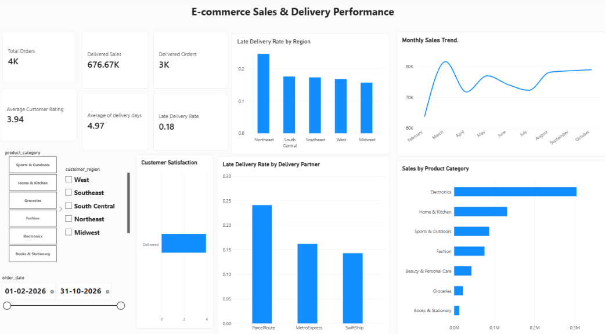

# ecommerce-sales-delivery-analysis
Excel, SQL and Power BI analysis of e-commerce sales and delivery performance
# 🛒 E-commerce Sales & Delivery Performance Analysis



An end-to-end analytics project: **Excel** for data cleaning and validation, **SQL (MySQL)** for analysis, **Power BI** for an interactive report, and data-backed business recommendations. The dataset has 5,000 order-item records from a fictional US e-commerce company.

---

## 📌 Business Scenario

As a **Junior Data Analyst**, I joined the analytics team of an e-commerce company operating across multiple US cities. Management wanted to:

- Understand **sales performance** by category, region and month
- Identify **delivery-related problems**
- Investigate **customer satisfaction** and whether delays affect it

---

## 🛠 Tools Used

| Tool | Purpose |
|---|---|
| **Excel** | Data cleaning, validation, cleaning log |
| **MySQL** | Business analysis queries |
| **Power BI** | Interactive dashboard with DAX measures |
| **GitHub** | Portfolio and version control |

---

## 📂 Repository Structure

```
ecommerce-sales-delivery-analysis/
├── E-commerce_cleaned_data.xlsx            # Raw_data, Cleaned_Data, Data validation, Data Cleaning Log
├── Ecommerce_Delivery_Analytics_Queries.sql
├── e-commerce_analysis.pbix
├── github_dashboard_1280x640.png
├── dashboard_full.png
└── README.md
```

---

## 📊 Dataset

- **Raw records:** 5,000 order-item rows (an order can contain several items)
- **Cleaned records:** 4,975 rows covering **3,599 distinct orders**
- **Order dates:** 01 Feb 2026 to 31 Oct 2026
- **Order status:** Delivered, Cancelled, Processing, Shipped
- **Regions:** Midwest, West, Southeast, South Central, Northeast
- **Delivery partners:** ParcelRoute, MetroExpress, SwiftShip
- **Categories:** 7 product categories

**Key columns:** `order_item_id`, `order_id`, `item_number`, `order_date`, `order_status`, `customer_region`, `customer_city`, `fulfillment_center`, `delivery_partner`, `seller_id`, `product_category`, `product_id`, `quantity`, `unit_price_usd`, `discount_usd`, `shipping_fee_usd`, `payment_method`, `promised_delivery_date`, `dispatch_date`, `actual_delivery_date`, `review_score`

### Business rules used throughout
| Rule | Definition |
|---|---|
| **Order-level KPIs** | Count **distinct `order_id`**, because one order can have several items |
| **Delivered sales** | Σ (`quantity` × `unit_price_usd` − `discount_usd`) for **delivered** items only; shipping fee excluded |
| **Late delivery** | `actual_delivery_date` later than `promised_delivery_date` |
| **Late delivery rate** | Late delivered orders ÷ delivered orders |
| **Customer rating** | One review per order (the review is repeated on every item of an order, so it is counted once to **avoid double-counting**) |

---

## 🧹 Part 1: Excel Data Cleaning

The original data is **preserved untouched** in the `Raw_data` sheet. All cleaning was done in `Cleaned_Data`, with a `Data validation` sheet and a `Data Cleaning Log` sheet in the same workbook.

| Issue | Action | Result |
|---|---|---|
| **Duplicate records** | Removed exact duplicate rows (same `order_item_id`) | 25 duplicates removed (5,000 → 4,975 rows) |
| **Unique ID check** | Checked `order_item_id` with `COUNTIF` | Passed |
| **Missing customer region** | Filled using the city → region mapping (each city maps to one region) | 19 fixed |
| **Missing customer city** | 11 filled from other items in the same order; 19 imputed with the most common city of that region | 30 fixed |
| **Category labels** | Trimmed spaces and fixed lowercase text | 24 rows fixed, 14 variants → 7 categories |
| **Payment-method labels** | Trimmed spaces and fixed lowercase text | 18 rows fixed, 8 variants → 4 methods |
| **Missing dispatch date** | Kept: cancelled, processing and shipped orders legitimately have none | 226 blanks retained |
| **Missing actual delivery date** | Kept for the same reason | 241 blanks retained |
| **Missing review score** | Left blank (no review was given); no imputation in the source data | 830 blanks retained |
| **Stray rows / helper columns** | Removed a leftover summary row and a constant helper column | Completed |

### Validation results
| Check | Result |
|---|---|
| Dates | All valid (Feb to Nov 2026). No dispatch before order, no delivery before dispatch, no promised date before order, no future dates |
| Quantity | Whole numbers between 1 and 3; no zero or negative values |
| Unit price | Between $5.02 and $498.20; no zero, negative or text values |
| Discount | Never negative and never above the line value (maximum 20%) |
| Delivered orders | None with a blank dispatch or delivery date |

---

## 🗃 Part 2: SQL Analysis

All queries are in [`Ecommerce_Delivery_Analytics_Queries.sql`](Ecommerce_Delivery_Analytics_Queries.sql) (MySQL, table `customers` in database `ecommerce_db`).

| # | Query | Business question |
|---|---|---|
| 1 | Total orders, delivered orders, delivered sales | How big is the business? |
| 2 | Monthly sales trend | How do sales move over time? |
| 3 | Sales by product category | Which categories earn the most? |
| 4 | Sales by customer region | Which regions earn the most? |
| 5 | Delayed deliveries with delay days | Which orders arrived late and by how much? |
| 6 | Average rating by product category | Which categories are rated highest? |
| 7 | Average rating: delayed vs on-time | Do delays hurt ratings? |
| 8 | Late-delivery rate by region | Where are delays concentrated? |
| 9 | Delivery performance by partner | Which courier performs worst? |
| 10 | Order-level rating: late vs on-time | Do delays hurt ratings (no double-counting)? |

**Example: KPIs**
```sql
SELECT
    COUNT(DISTINCT order_id) AS total_orders,
    COUNT(DISTINCT CASE WHEN LOWER(TRIM(order_status)) = 'delivered'
                        THEN order_id END) AS delivered_orders,
    SUM(CASE WHEN LOWER(TRIM(order_status)) = 'delivered'
             THEN quantity * unit_price_usd - IFNULL(discount_usd, 0)
             ELSE 0 END) AS delivered_sales
FROM customers;
```

**Late-delivery rate by region (order level)**
```sql
SELECT
    customer_region,
    COUNT(*) AS delivered_orders,
    SUM(is_late) AS late_orders,
    ROUND(100 * SUM(is_late) / COUNT(*), 1) AS late_rate_pct
FROM (
    SELECT order_id,
           MIN(customer_region) AS customer_region,
           MAX(CASE WHEN STR_TO_DATE(actual_delivery_date, '%d-%m-%Y')
                      > STR_TO_DATE(promised_delivery_date, '%d-%m-%Y')
                    THEN 1 ELSE 0 END) AS is_late
    FROM customers
    WHERE LOWER(TRIM(order_status)) = 'delivered'
    GROUP BY order_id
) t
GROUP BY customer_region
ORDER BY late_rate_pct DESC;
```

**Delivery performance by partner**
```sql
SELECT
    delivery_partner,
    COUNT(*) AS delivered_orders,
    SUM(is_late) AS late_orders,
    ROUND(100 * SUM(is_late) / COUNT(*), 1) AS late_rate_pct
FROM (
    SELECT order_id,
           MIN(delivery_partner) AS delivery_partner,
           MAX(CASE WHEN STR_TO_DATE(actual_delivery_date, '%d-%m-%Y')
                      > STR_TO_DATE(promised_delivery_date, '%d-%m-%Y')
                    THEN 1 ELSE 0 END) AS is_late
    FROM customers
    WHERE LOWER(TRIM(order_status)) = 'delivered'
    GROUP BY order_id
) t
GROUP BY delivery_partner
ORDER BY late_rate_pct DESC;
```

**Ratings: late vs on-time, one review per order**
```sql
SELECT
    CASE WHEN is_late = 1 THEN 'Delayed' ELSE 'On Time' END AS delivery_status,
    COUNT(review_score) AS reviewed_orders,
    ROUND(AVG(review_score), 2) AS average_rating
FROM (
    SELECT order_id,
           MAX(CASE WHEN STR_TO_DATE(actual_delivery_date, '%d-%m-%Y')
                      > STR_TO_DATE(promised_delivery_date, '%d-%m-%Y')
                    THEN 1 ELSE 0 END) AS is_late,
           MAX(CAST(NULLIF(TRIM(review_score), '') AS DECIMAL(3,1))) AS review_score
    FROM customers
    WHERE LOWER(TRIM(order_status)) = 'delivered'
    GROUP BY order_id
) t
GROUP BY is_late;
```

---

## 📈 Part 3: Power BI Report


### KPIs
| KPI | Value |
|---|---|
| **Total Orders** | 3,599 |
| **Delivered Sales** | $676.67K |
| **Delivered Orders** | 3,430 |
| **Late Delivery Rate** | 18.4% |
| **Average Customer Rating** | 3.94 |

An extra card shows **Average Delivery Days (4.97)**.

### Visuals
| Visual | Purpose |
|---|---|
| Line chart: Monthly Sales Trend | Sales movement from Feb to Oct 2026 |
| Bar chart: Sales by Product Category | Category revenue comparison |
| Column chart: Late Delivery Rate by Region | Regional delay hotspots |
| Column chart: Late Delivery Rate by Delivery Partner | Courier performance |
| Bar chart: Average Review Score, On-time vs Late | Link between delays and satisfaction |

### Interactive slicers
**Order date**, **Customer region** and **Product category**.

---

## 💡 Part 4: Business Analysis

### 1. Which categories and regions generate the highest sales?

Total delivered sales were **$676,669**.

| Category | Sales | Share |
|---|---|---|
| **Electronics** | $304,550 | 45.0% |
| Home & Kitchen | $131,801 | 19.5% |
| Sports & Outdoors | $87,153 | 12.9% |
| Fashion | $75,560 | 11.2% |
| Beauty & Personal Care | $43,105 | 6.4% |
| Groceries | $21,797 | 3.2% |
| Books & Stationery | $12,702 | 1.9% |

| Region | Sales | Delivered Orders |
|---|---|---|
| **Midwest** | $152,189 | 707 |
| West | $139,356 | 706 |
| Southeast | $130,322 | 663 |
| South Central | $128,006 | 681 |
| Northeast | $126,796 | 673 |

**Electronics** alone brings in almost half of all revenue. **Midwest** is the top region, but regional sales are fairly close (Midwest leads the lowest region by about 20%). Monthly sales peaked in **March ($81.6K)**, dipped in April, and recovered to about **$79K in October**.

### 2. Which regions experience the most delivery delays?

Overall, **631 of 3,430 delivered orders (18.4%)** arrived after the promised date.

| Region | Late Rate | Late Orders |
|---|---|---|
| **Northeast** | **24.7%** | 166 |
| South Central | 17.6% | 120 |
| Southeast | 17.3% | 115 |
| West | 16.9% | 119 |
| Midwest | 15.7% | 111 |

| Delivery Partner | Late Rate | Delivered Orders |
|---|---|---|
| **ParcelRoute** | **24.1%** | 1,295 |
| MetroExpress | 16.2% | 709 |
| SwiftShip | 14.3% | 1,426 |

- **Northeast is late with every partner** (20.8% to 30.5%), so the problem is regional and not only about one courier.
- **ParcelRoute is the worst partner in every region.** The gap is biggest in the West (26.2% vs 9.6% for SwiftShip) and the Southeast (23.4% vs 10.7%).
- **Northeast + ParcelRoute is the worst combination at 30.5%.**
- Dispatch is fast and consistent (about 1 day after ordering at every fulfillment center), so the delay happens **in transit**, not in the warehouse.

### 3. Do delayed orders tend to receive lower customer ratings?

**Yes, clearly.**

| Delivery Status | Reviewed Orders | Average Rating |
|---|---|---|
| On time | 2,447 | **4.15** |
| Delayed | 553 | **3.01** |

Late orders score **about 1.1 stars lower**. The drop appears as soon as an order is even **one day late** (rating about 2.9 to 3.1), while orders delivered early or on the promised date all score about 4.1 to 4.2. The overall average rating is **3.94**, based on 3,000 reviewed orders.

### 4. What operational problems require attention?

- **ParcelRoute underperforms.** It delivers 38% of orders and is late 24.1% of the time, against 14.3% for SwiftShip.
- **The Northeast has the highest delay rate (24.7%)** and also the lowest sales of any region.
- **Almost 1 in 5 orders is late**, and each late order costs about one star of customer satisfaction.
- **Delays happen in transit.** Dispatch is fast everywhere, so the issue is carrier and last-mile performance.
- **Revenue is concentrated in Electronics (45%)**, which is a dependency risk.
- **Order loss:** 145 orders (4.0%) were cancelled, and 24 more are still processing or shipped.
- **Missing feedback:** 430 delivered orders (12.5%) have no review, which limits satisfaction insight.

### 5. Three improvements management should consider

1. **Hold ParcelRoute to a delivery SLA and shift volume.** Set a late-rate target with penalties, and move volume to SwiftShip and MetroExpress, starting in the West and Southeast where the gap is largest.
2. **Run a Northeast delivery review.** Every partner performs worse there, so check lanes, last-mile capacity and delivery promises for the region, and set realistic delivery dates until it improves.
3. **Protect customer satisfaction from delays.** Add buffer days to promised dates for high-risk routes, send proactive delay notifications, and offer a service recovery gesture for late orders, since delays reduce ratings from 4.15 to 3.01.

---

## 🎓 Key Learnings

- Using **distinct order IDs** for order-level KPIs when orders contain several items
- Avoiding **double-counted reviews** by taking one review per order
- Documenting cleaning decisions while **preserving the raw data**
- Writing **MySQL** queries with date conversion and order-level aggregation
- Building a **Power BI** dashboard with DAX measures and slicers
- Turning analysis into **specific, data-backed recommendations**

---

## 👤 Author

**Ramesh Erumalla**
Junior Data Analyst | Excel · SQL · Power BI

🔗 [LinkedIn](https://www.linkedin.com/in/ramesh-erumalla-bb897b297/)
💻 [GitHub](https://github.com/ramesherumalla)
